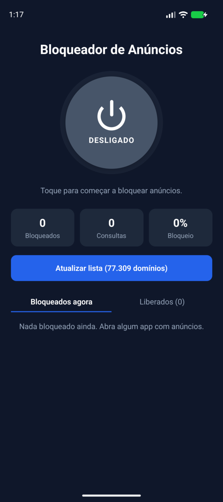
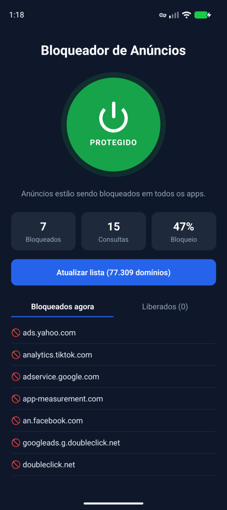
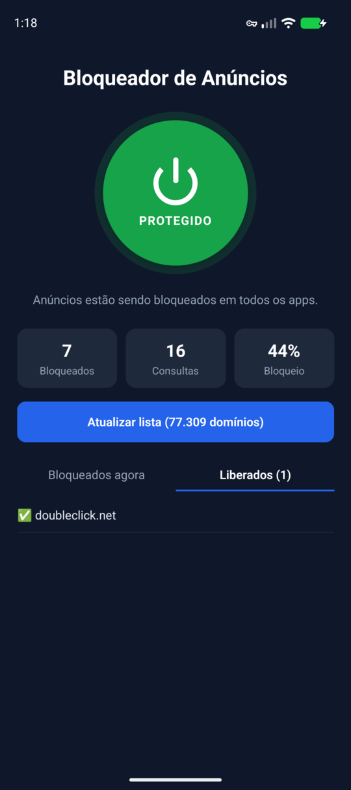

# Bloqueador de Anúncios (React Native, Android)

**Português** · [English](README.en.md)

App que bloqueia anúncios e rastreadores **em todos os apps do celular e da Android TV**, sem root.
[Como instalar na TV](#instalar-na-android-tv--google-tv-sem-a-loja).

<p align="center">
  
  
  
</p>

## Baixar

**[⬇ Baixar o APK (última versão)](https://github.com/joaogabriel15/adblocker/releases/latest/download/adblocker.apk)**,
ou veja todas as versões em [Releases](https://github.com/joaogabriel15/adblocker/releases).

Para instalar no Android:

1. Abra o link no celular e baixe o `adblocker.apk`.
2. Ao abrir o arquivo, o Android pede para **permitir instalar apps desta fonte** (navegador ou
   gerenciador de arquivos). Permita.
3. O **Play Protect** pode avisar que o app é desconhecido, porque ele não está na Play Store.
   Toque em "Mais detalhes" > "Instalar mesmo assim".
4. Abra o app e ligue o bloqueio. O Android pergunta se aceita a conexão VPN: aceite.

Versões novas instalam por cima da anterior, sem perder os domínios liberados.

> **Privacidade:** a VPN só enxerga as consultas de DNS (nomes de sites), e elas não saem do
> celular, a não ser para o DNS público (1.1.1.1 / 8.8.8.8). O app não tem servidor, conta
> nem coleta de dados; a única conexão própria é o download da lista no GitHub, quando você
> toca em "Atualizar lista". O código está todo aqui. Baixe o APK só desta página de Releases.

## Instalar na Android TV / Google TV (sem a loja)

O app também funciona em **TVs com Android TV ou Google TV** (Sony, Philips, TCL, Xiaomi Mi Box,
Chromecast com Google TV, Fire TV etc.). Ele aparece na tela inicial da TV e dá para usar só com o
controle remoto. Como ele não está na Play Store, é preciso instalar o APK "por fora" (sideload).
Escolha um dos jeitos abaixo.

### Jeito 1: app Downloader (mais fácil, sem computador)

1. Na TV, instale o app **Downloader** (da AFTVnews) pela Play Store da própria TV.
2. Libere a instalação: Configurações > Privacidade (ou Segurança e restrições) >
   **Fontes desconhecidas** (ou "Instalar apps desconhecidos") > ative para o **Downloader**.
   Na Google TV, se não achar a opção, vá em Configurações > Sistema > Sobre > clique 7 vezes em
   "Build do Android TV OS" para liberar o modo desenvolvedor, e procure de novo.
3. Abra o Downloader e digite o endereço do APK:
   `https://github.com/joaogabriel15/adblocker/releases/latest/download/adblocker.apk`
   (ou o link do APK gerado pelo EAS, veja abaixo).
4. Quando terminar de baixar, escolha **Instalar**.

### Jeito 2: pen drive

1. Baixe o `adblocker.apk` no computador e copie para um pen drive.
2. Na TV, instale um gerenciador de arquivos (ex.: **File Commander**, **X-plore** ou
   **FX File Explorer**) e libere "Fontes desconhecidas" para ele (passo 2 do jeito 1).
3. Espete o pen drive na TV, abra o APK pelo gerenciador de arquivos e instale.

### Jeito 3: app "Send Files to TV"

Instale o **Send Files to TV** no celular e na TV, envie o `adblocker.apk` do celular para a TV
pela mesma rede Wi-Fi e abra o arquivo na TV com um gerenciador de arquivos.

### Jeito 4: ADB pela rede (para quem tem computador)

1. Na TV, ative o **modo desenvolvedor** (Configurações > Sistema > Sobre > clique 7 vezes em
   "Build") e depois ligue **Depuração por USB / Depuração de rede** nas Opções do desenvolvedor.
2. Descubra o IP da TV (Configurações > Rede > Wi-Fi > sua rede).
3. No computador, com o [Android platform-tools](https://developer.android.com/tools/releases/platform-tools):

```bash
adb connect 192.168.0.50        # troque pelo IP da TV; aceite o aviso que aparece na TV
adb install -r adblocker.apk
```

### E o Expo? Dá para instalar pelo Expo Go?

**Não pelo Expo Go**: o app tem código nativo próprio (a VPN), que o Expo Go não carrega, e o
Expo Go nem existe na loja da TV. Mas dá para usar o **EAS Build** (o serviço de build do Expo)
para gerar o APK na nuvem e baixar direto na TV:

```bash
npx eas-cli@latest build -p android --profile preview
```

No fim o EAS mostra um link do APK (`https://expo.dev/artifacts/...`). Digite esse link no app
**Downloader** da TV (jeito 1) e instale. Dica: para não digitar um link longo com o controle,
encurte-o (ex.: bit.ly) ou use o código numérico do próprio Downloader (aftv.news).

### Usando na TV

1. Abra **Bloqueador de Anúncios** na tela inicial (na Google TV pode estar em "Seus apps").
2. Com o botão de ligar em destaque (borda amarela), aperte **OK** no controle.
3. A TV pergunta se aceita a conexão VPN: escolha **OK**.
4. Use as setas para andar entre os botões e a lista. Aperte OK num domínio para liberá-lo.

**Problemas comuns na TV:**

- **"Este aparelho não tem a tela de permissão de VPN"**: algumas TVs vêm sem essa tela. Pelo
  computador (jeito 4), rode uma vez e depois ligue de novo no app:
  `adb shell appops set com.adblocker ACTIVATE_VPN allow`
- **Não aparece na tela inicial**: procure em Configurações > Apps, ou em "Seus apps".
- **Não religou depois de ligar a TV**: veja "Sempre ativo em segundo plano" abaixo. Algumas
  marcas (ex.: Fire TV e TVs com "início rápido" desligado) bloqueiam apps de abrir sozinhos no
  boot; nesse caso use a "VPN sempre ativa" pelo ADB.
- **DNS privado / DNS seguro**: assim como no celular, desative se a TV tiver essa opção.
- Anúncios do app do **YouTube** continuam aparecendo (veja a seção "Importante" abaixo); já os
  de muitos apps de canais, IPTV e jogos são bloqueados.

## Sempre ativo em segundo plano

Você só precisa ligar o bloqueio **uma vez**. Depois disso:

- Ele continua rodando em segundo plano mesmo com o app fechado ou com outro app aberto
  (é um serviço em primeiro plano, e o Android não o fecha para liberar memória). No celular
  aparece uma notificação discreta "Bloqueador de Anúncios ativo".
- Quando o celular ou a TV **liga de novo**, o app religa o bloqueio sozinho, desde que ele
  estivesse ligado. Também religa depois de instalar uma versão nova.
- Ele só fica desligado se você desligar no app, pela tela de VPN do Android, ou se outro app de
  VPN assumir.

Para garantir ainda mais (o Android religa a VPN mesmo se o app for fechado à força), ative a
**VPN sempre ativa**:

- **Celular:** Configurações > Rede e Internet > VPN > ⚙️ ao lado de "AdBlocker" > **VPN sempre ativa**.
- **TV:** muitas TVs não mostram essa tela. Pelo computador (jeito 4 acima), rode:

```bash
adb shell settings put secure always_on_vpn_app com.adblocker
adb shell settings put secure always_on_vpn_lockdown 0   # 0 = não corta a internet se a VPN cair
```

Para desfazer: `adb shell settings delete secure always_on_vpn_app`.

## Como funciona

O app cria uma **VPN local** (nada sai do seu celular por ela). Essa VPN só captura
as consultas de DNS, que é quando um app pergunta "qual o endereço de `ads.exemplo.com`?".

- Se o domínio está na lista de anúncios/rastreio, o app responde `0.0.0.0` e o anúncio não carrega.
- Se não está, a consulta é repassada normalmente ao DNS da Cloudflare (1.1.1.1) ou Google (8.8.8.8).

O resto do tráfego (vídeos, mensagens, etc.) **não passa** pela VPN, então não deixa a internet mais lenta
e quase não gasta bateria.

A lista vem embutida (StevenBlack hosts, ~77 mil domínios, licença MIT) e pode ser atualizada
pelo botão "Atualizar lista".

## Recursos

- Botão liga/desliga
- Contador de consultas e de bloqueios
- Lista dos últimos domínios bloqueados
- Toque num domínio bloqueado para **liberá-lo** (útil se algum app quebrar)
- Funciona na **Android TV / Google TV**, com navegação pelo controle remoto
- Fica ligado em segundo plano e **religa sozinho** quando o aparelho liga
- Compatível com "VPN sempre ativa" do Android (Configurações > Rede > VPN > ⚙️ > Sempre ativa)

## Rodando

Pré-requisitos: Node 22+, JDK 17+, Android Studio com Android SDK, e um celular Android
com depuração USB ativa (ou um emulador).

```bash
npm install
npm start          # em um terminal (Metro)
npm run android    # em outro terminal, instala no celular
```

Para gerar um APK instalável sem o computador:

```bash
cd android
./gradlew assembleRelease
# APK em android/app/build/outputs/apk/release/app-release.apk
```

> O build de release usa a chave de debug por padrão (veja `android/app/build.gradle`).
> Para uso pessoal isso basta; para publicar na Play Store, gere sua própria chave.

Ou gerar o APK na nuvem pelo EAS (sem Android Studio; a chave fica guardada no EAS):

```bash
npx eas-cli@latest build -p android --profile preview
# no fim sai o link do APK
```

> O `eas.json` fixa `"image": "latest"`: sem o pacote `expo`, o EAS cairia numa imagem
> antiga (JDK 11 / Node 18) que não compila o React Native 0.88.

### Publicar uma versão nova

1. Suba `versionCode` (+1) e `versionName` em `android/app/build.gradle`.
2. Gere o APK no EAS (comando acima) e baixe-o como `adblocker.apk`.
3. Crie a release com o APK anexado (o nome `adblocker.apk` mantém o link "Baixar" do topo):

```bash
gh release create v1.0.1 adblocker.apk --title "v1.0.1" --notes "O que mudou"
```

> Sempre gere pelo EAS: a chave que assina o APK fica guardada lá. Um APK assinado com outra
> chave não instala por cima da versão anterior. Guarde um backup da chave fora do repositório
> (`npx eas-cli@latest credentials -p android` > Keystore > Download).

## Importante: o que ele bloqueia e o que não bloqueia

**Bloqueia bem:** anúncios de redes como Google AdMob/DoubleClick, Facebook Audience Network,
Unity Ads, AppLovin, ironSource etc. Isso cobre a maioria dos jogos e apps gratuitos.

**Não consegue bloquear:**
- Anúncios do **YouTube, Instagram, Facebook, TikTok e Twitch**: eles vêm do mesmo servidor do
  conteúdo. Bloquear o anúncio derrubaria o app inteiro.
- Apps que usam DNS próprio criptografado (DoH) ignoram a VPN.

**Desative o "DNS privado"** do Android, senão o bloqueio não funciona:
Configurações > Rede e Internet > DNS privado > **Desativado** (ou "Automático").
No Chrome, desative também Configurações > Privacidade > "Usar DNS seguro".

**iPhone:** a Apple não permite que um app filtre o DNS de outros apps desta forma.
O app abre no iOS, mas só mostra um aviso.

## Estrutura

```
App.tsx                         Tela (React Native)
src/AdBlock.ts                  Ponte JS para o módulo nativo
android/app/src/main/java/com/adblocker/vpn/
  AdBlockVpnService.kt          VPN local que intercepta DNS
  DnsPacket.kt                  Leitura/escrita de pacotes IP/UDP/DNS
  Blocklist.kt                  Lista de bloqueio, download e domínios liberados
  AdBlockModule.kt              Módulo nativo exposto ao JS (NativeModules.AdBlock)
  AdBlockPackage.kt             Registro do módulo
android/app/src/main/assets/hosts_basic.txt   Lista embutida
```

## Licença

[MIT](LICENSE). A lista de bloqueio embutida é a [StevenBlack/hosts](https://github.com/StevenBlack/hosts),
também MIT, e mantém o cabeçalho original em `android/app/src/main/assets/hosts_basic.txt`.
